# Export CRM — Gmail-driven inquiry management

A CRM I built for an organic food exporter (a client) that turns the sales team's shared Gmail
inboxes into a managed sales pipeline — leads, quotes, purchase orders and follow-ups — with an
AI assistant that reads each incoming email so people don't have to re-type it.
**Version 1.0.0**, live in production since October 2026.

> **Portfolio showcase.** This repository contains screenshots and a write-up only. The source
> code is private because it was built for a client. All data shown is fictional demo data (no
> real people, companies, contact details or prices). A live walkthrough is available on request.

## At a glance

| | |
|---|---|
| **Type** | Web application (CRM) |
| **Version** | 1.0.0 (launch release) |
| **Integrations** | Gmail API (service account with domain-wide delegation), Google Gemini API |
| **Roles** | Sales Person, Head of Department, CEO, System Admin |
| **Stack** | PHP 8 (no framework), MariaDB/MySQL (PDO, prepared statements), Composer |
| **Hosting** | VPS (AlmaLinux, CyberPanel/OpenLiteSpeed, Cloudflare), deployed with git |

## What it does

- **Reads Gmail automatically.** Shared and personal inboxes are watched through a Google service account
  with domain-wide delegation, every five minutes. New mail becomes a lead, and replies are added to the right
  conversation by Gmail thread. The system only reads and labels mail: nothing in it sends email to customers.
- **Filters junk before it reaches a person.** A rule-based spam score and Gemini AI classify each email as a
  genuine buyer inquiry, not an inquiry (spam, supplier pitches, phishing) or uncertain. Uncertain mail goes to a
  **Needs Review** queue where the head of department confirms or dismisses it, instead of being guessed either way.
- **Extracts the buyer's details.** Name, company, country, phone, website, address, certifications,
  products and quantities are pulled from the email and attached to the lead.
- **Keeps one record per buyer.** New senders are matched to existing customers by email, phone number or
  company, and blank fields are filled in without overwriting good data.
- **Sales pipeline.** Lead statuses (New → Assigned → Contacted → Quoted → Won / Lost) follow what actually
  happened: only the company's own replies move a lead forward. Quotes and purchase orders can be drafted by the AI
  from an email or attachment and stay clearly marked until a person confirms them.
- **Follow-up reminders**, a **PO items summary** that totals what production needs to prepare (weights
  normalised to kilograms, with a CSV download), and role-based dashboards for sales people, the head of department,
  the CEO (with date ranges) and a system administrator.
- **Administration built in.** Users are added with a temporary password and must choose their own at first
  sign-in; people can be disabled or deleted safely (their leads are handed over and the conversation history is
  kept); a sign-in activity report shows who is using the system.

## Screenshots

<table>
  <tr>
    <td width="50%">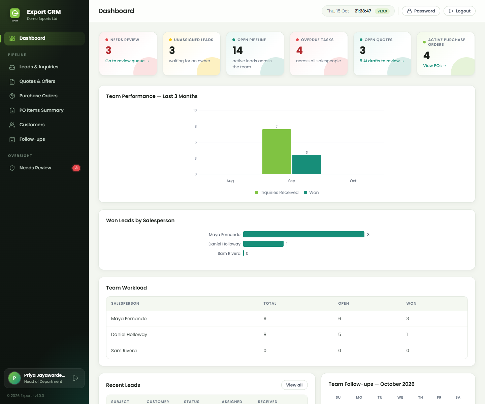 <b>Head of department dashboard.</b> Where the team's work is waiting.</td>
    <td width="50%">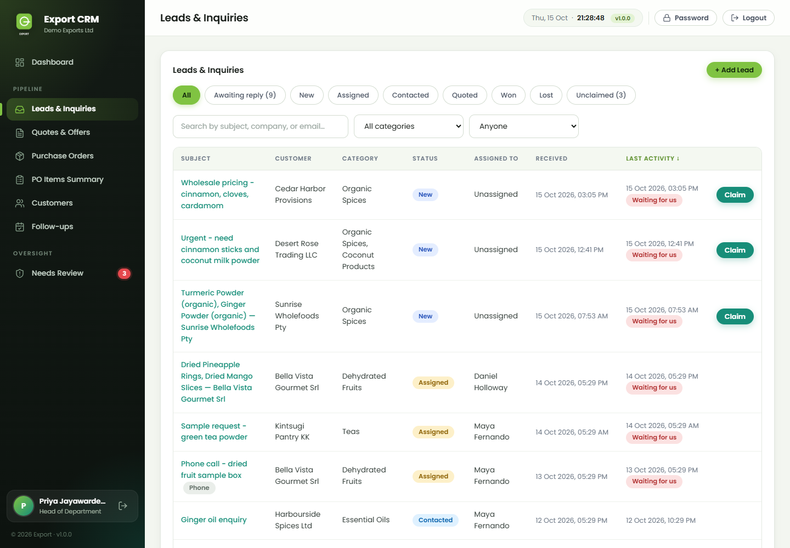 <b>Leads list</b> with filters and one-click claim.</td>
  </tr>
  <tr>
    <td>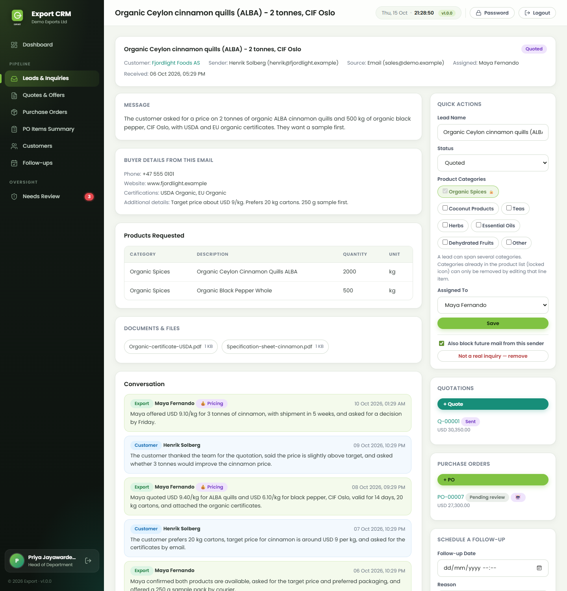 <b>Lead detail</b> with the buyer's details and the email conversation.</td>
    <td>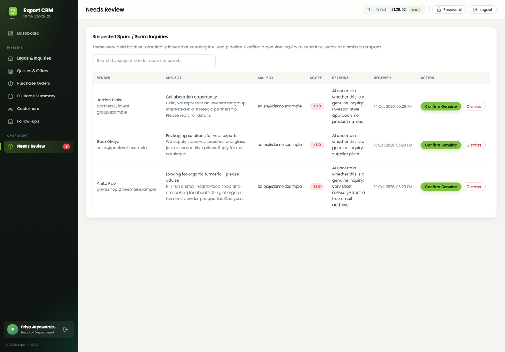 <b>Needs Review queue</b> for emails the AI is unsure about.</td>
  </tr>
  <tr>
    <td>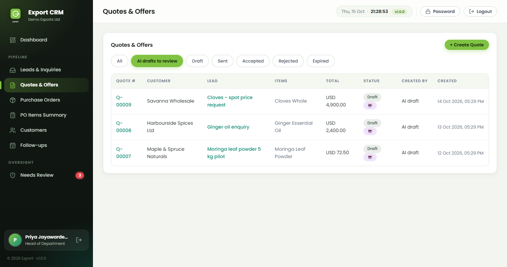 <b>Quotes</b> with AI drafts, marked until a person confirms them.</td>
    <td>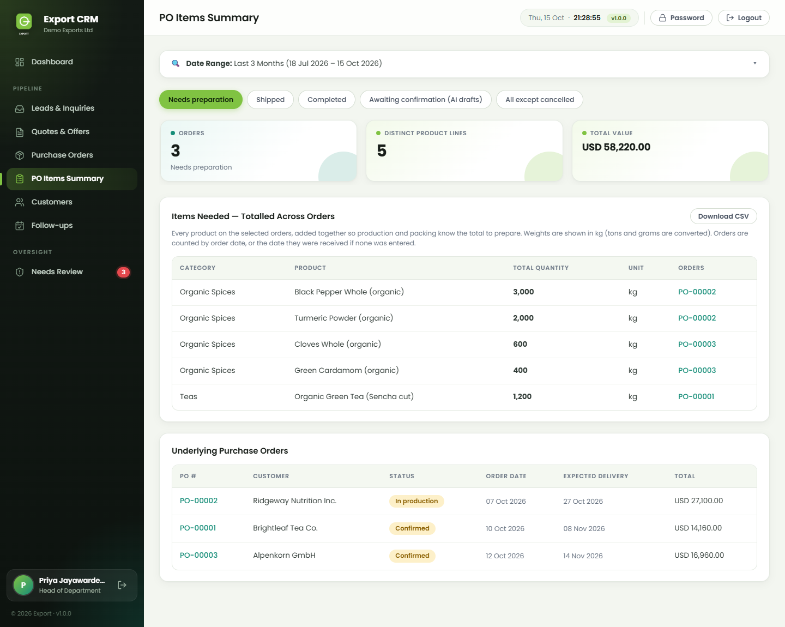 <b>PO items summary</b> of what production needs to prepare.</td>
  </tr>
  <tr>
    <td>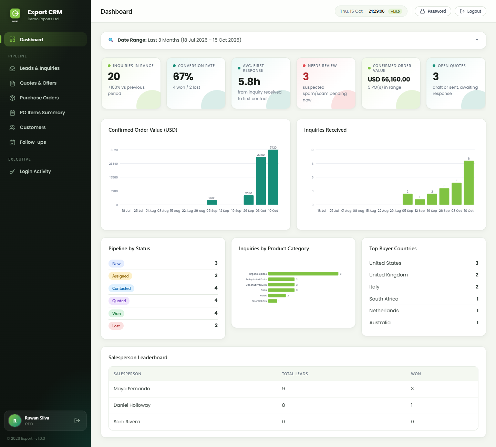 <b>CEO dashboard</b> with a date range.</td>
    <td>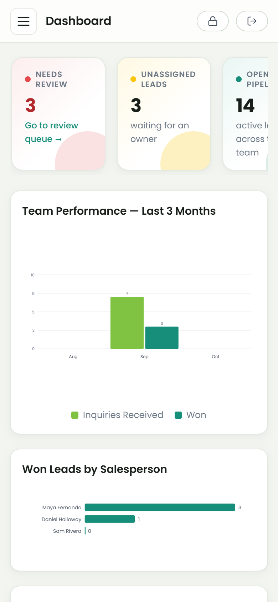 <b>Phone layout.</b> The same dashboard on a mobile screen.</td>
  </tr>
</table>

More screens

<table>
  <tr>
    <td width="50%">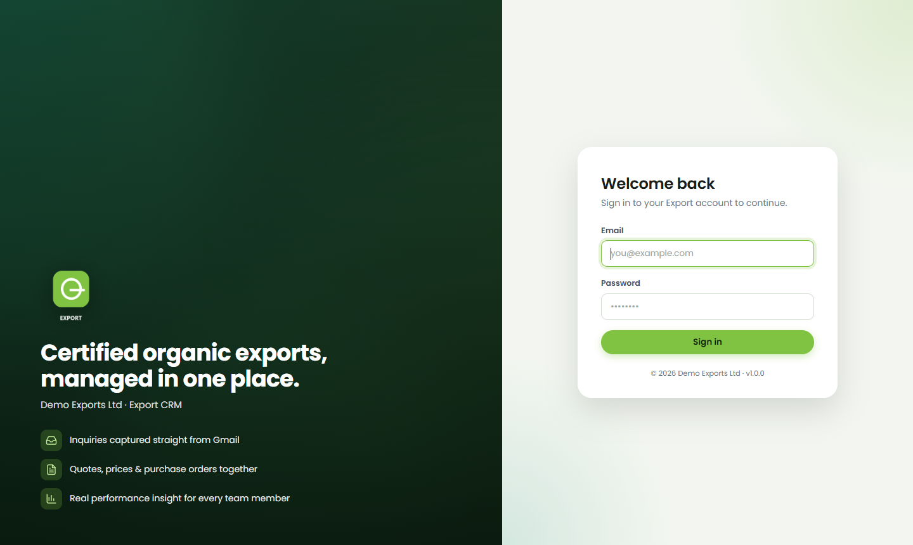 <b>Sign-in page.</b></td>
    <td width="50%">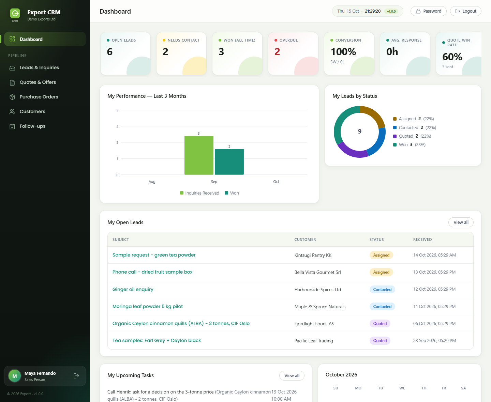 <b>Sales person dashboard</b> with personal performance.</td>
  </tr>
  <tr>
    <td>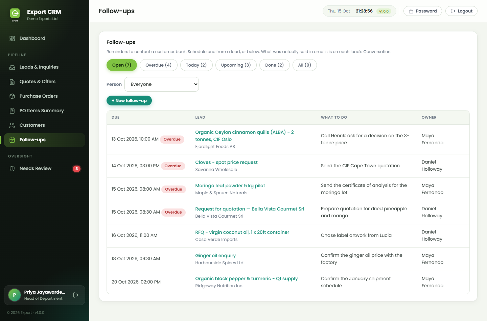 <b>Follow-ups</b> with tabs for overdue, today and upcoming.</td>
    <td>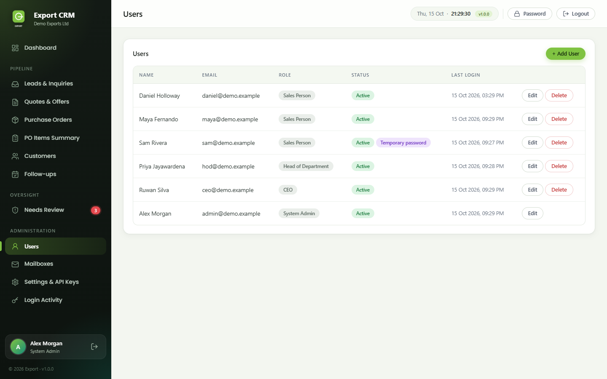 <b>User administration</b> for the system administrator.</td>
  </tr>
  <tr>
    <td>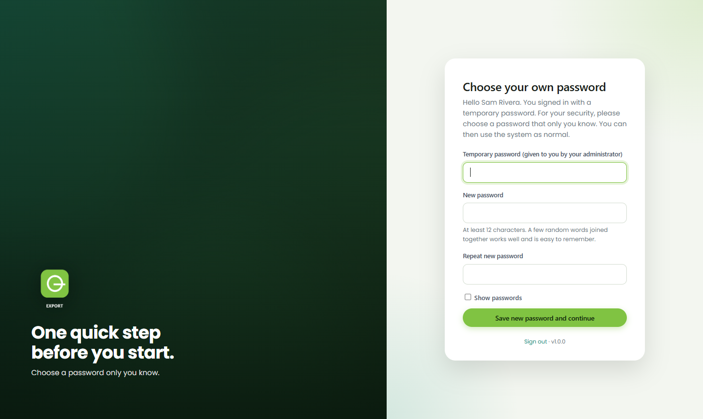 <b>First sign-in.</b> A temporary password must be replaced at once.</td>
    <td>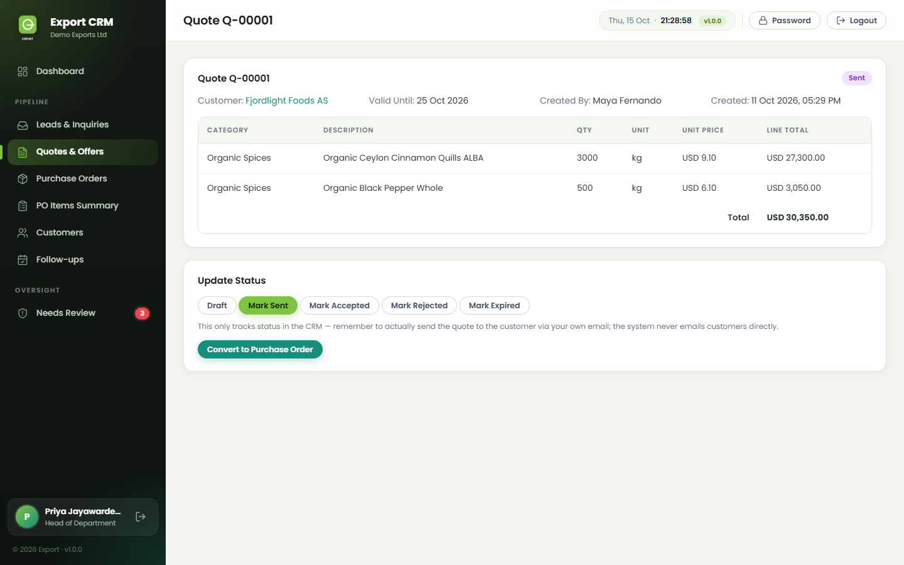 <b>Quote detail</b> with status buttons. A saved quote is never edited.</td>
  </tr>
</table>

## How it works

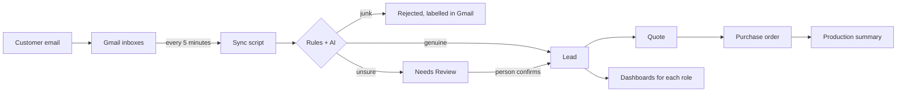

## Engineering highlights

- **A person always decides.** The AI can only draft. A drafted quote or order stays marked and is not counted
  anywhere until someone sets its status, and every AI call has a rule-based fallback so mail is never blocked.
- **Safe by layout.** Only a `public/` folder is served; code, config and uploads sit above it. Secrets in the database
  are encrypted (AES-256-GCM), every form carries a CSRF token, and all queries are prepared statements.
- **Sessions and files that cannot be abused.** A sign-in ends after 30 minutes without a click and after 12 hours in all, enforced on the
  server whatever the browser does with its cookie. Attachments from outside senders are shown in the browser only when they really are
  PDFs or ordinary pictures; everything else downloads. Pages send anti-framing, no-sniff and no-cache headers.
- **Security tested, not assumed.** About 60 scripted security checks (sign-in, access control, injection, files, headers) are run on a
  dummy-data copy before each release, and a short read-only check is made on the live address afterwards.
- **Accounts that cannot hurt you.** Users are re-checked on every request (a disabled person is signed out at
  once), temporary passwords force a change, and deleting a user detaches their history first because the database
  would otherwise cascade-delete it.
- **Releases with a way back.** A deploy script (check, deploy, rollback) refuses to run if server code was edited,
  runs Composer only when needed, and finishes with a health check that proves private files are not reachable.
- **Tested like each user.** More than 200 scripted checks ran as each of the four roles on a dummy-data copy,
  including the refusals (what each role is not allowed to do).
- **Rules written down.** A business-rules and approval matrix, a methodology note for the scoring and KPI formulas,
  user manuals per role and a practice test pack were delivered with the system.

## My role

I designed and built the whole system: the database schema, the Gmail ingestion pipeline, the spam and AI
classification logic, the web interface and role permissions, the production deployment, and the handover
(documentation, training material and acceptance tests).

## What I learned

- **AI needs a safety net.** A model will sometimes contradict itself, and quota or access can disappear
  mid-run, so every AI call has a rule-based fallback and anything uncertain goes to a human.
- **Test against real mess.** Real inboxes are full of "Re: Re:" subjects, signatures full of links and vendors
  pitching you instead of buying. Most of the work was making the filters handle that without losing genuine buyers.
- **Reversible beats clever.** Backups before every data change, quarantine instead of delete, and
  migrations as numbered files made big clean-ups safe.
- **Deployment is part of the job.** Serving only a `public/` folder, a read-only deploy key, a deploy script with
  rollback and health checks, and verifying that sensitive URLs return 403/404.
- **Test as every role, not only as admin.** Walking through the system as each user type shows what each person
  really sees, and what the system refuses them.
- **A system is not done until people can use it.** Manuals, a one-page explanation and a practice test matter as much
  as the code.

## Tech stack

PHP 8 (no framework) · MariaDB / MySQL (PDO, prepared statements) · Google Gmail API · Google Gemini API ·
Composer · Python + Selenium (scripted browser testing) · OpenLiteSpeed + CyberPanel on an AlmaLinux VPS behind Cloudflare

## Built with AI assistance

I developed this project myself. When I ran into problems along the way (requirement gathering,
planning, testing, debugging or deployment), I used **[Claude](https://www.anthropic.com/claude)**
(by Anthropic) as an AI assistant to help me work through them.

---

*Built by Heshan. The source code is private. Contact me through my GitHub profile for a walkthrough.*
